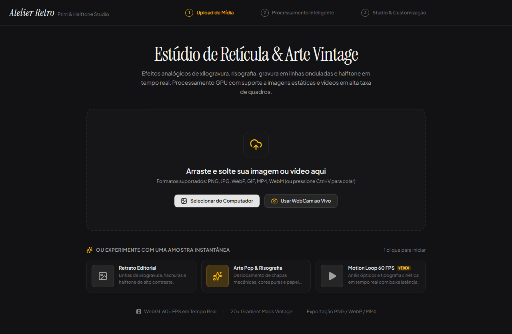
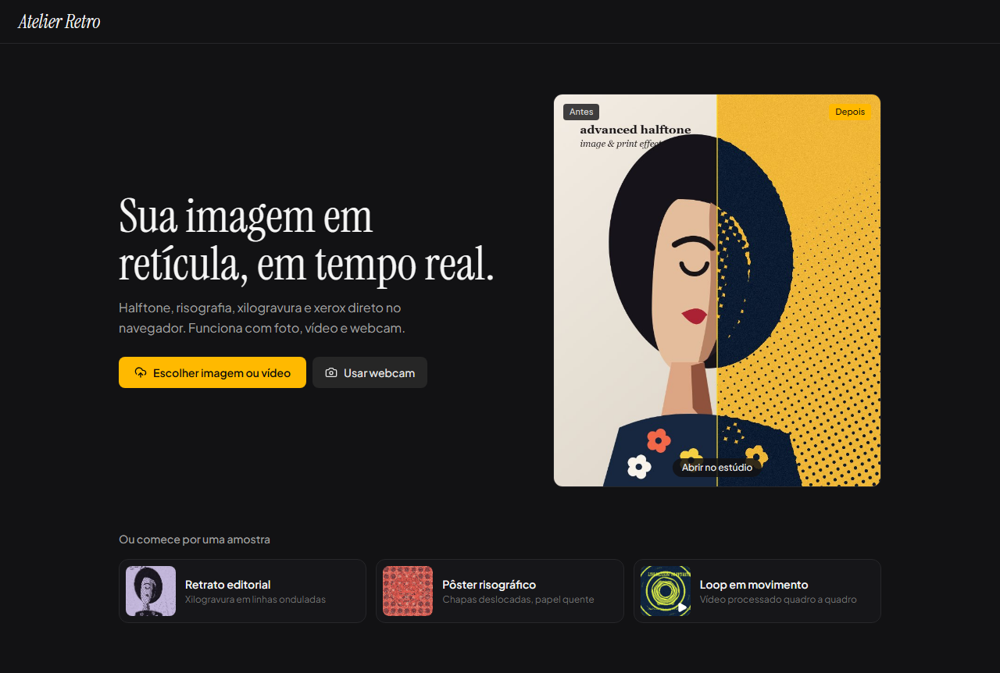
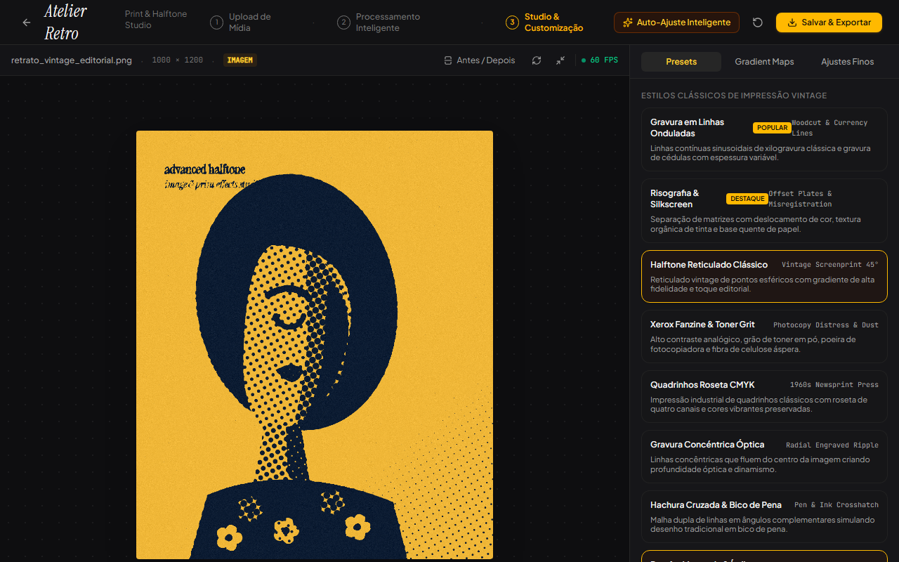
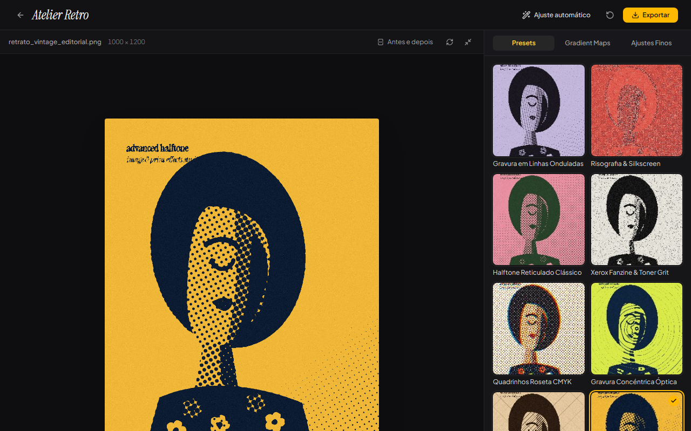
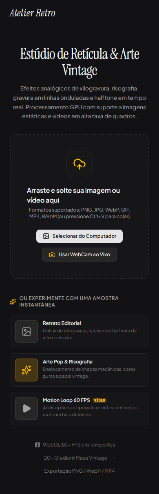
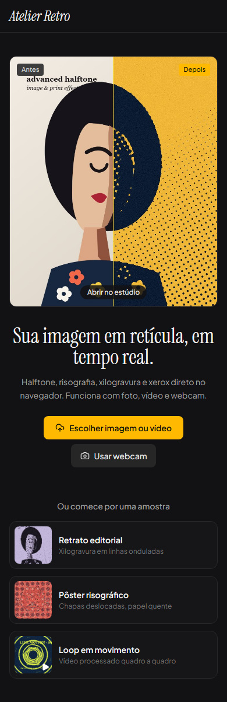
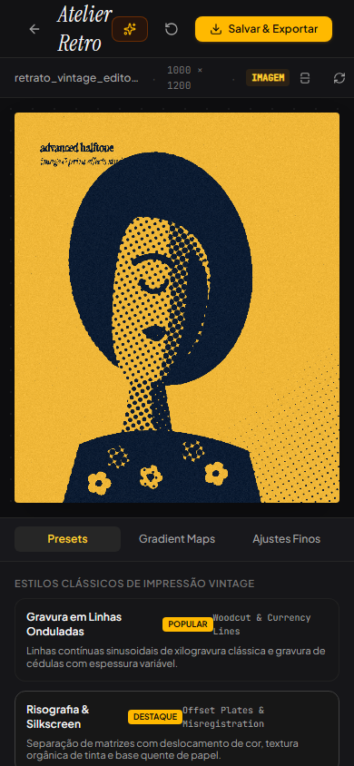
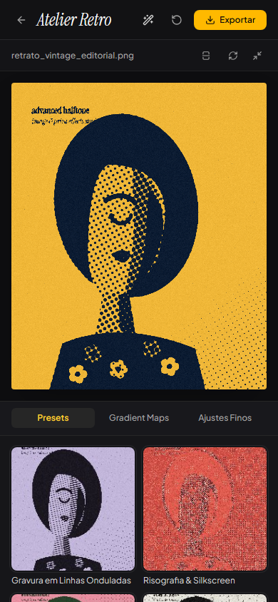

# Atelier Retro: halftone no navegador

App de exemplo do curso **IA Labs®** (Visant Club). Aplica halftone, risografia, xilogravura e xerox em foto, vídeo ou webcam, em tempo real.

Ele nasceu no Google AI Studio na aula 1.4, onde foi publicado na Vercel. Na aula B.10, passou pela auditoria de design com as [skills públicas da Visant](https://github.com/pedrojaques99/visant-skills-public).

## Antes e depois da skill

As mesmas telas, antes e depois da auditoria, em 1280 px e em 390 px (celular).

| | Antes | Depois |
|---|---|---|
| Início, 1280 |  |  |
| Estúdio, 1280 |  |  |
| Início, 390 |  |  |
| Estúdio, 390 |  |  |

O que mudou está no commit `design: auditoria com as skills da Visant`.

## Rodar local

```bash
npm install
npm run dev
```

O `.env.example` mostra as variáveis. A chave do Gemini nunca entra no repositório.

## Licença

MIT
